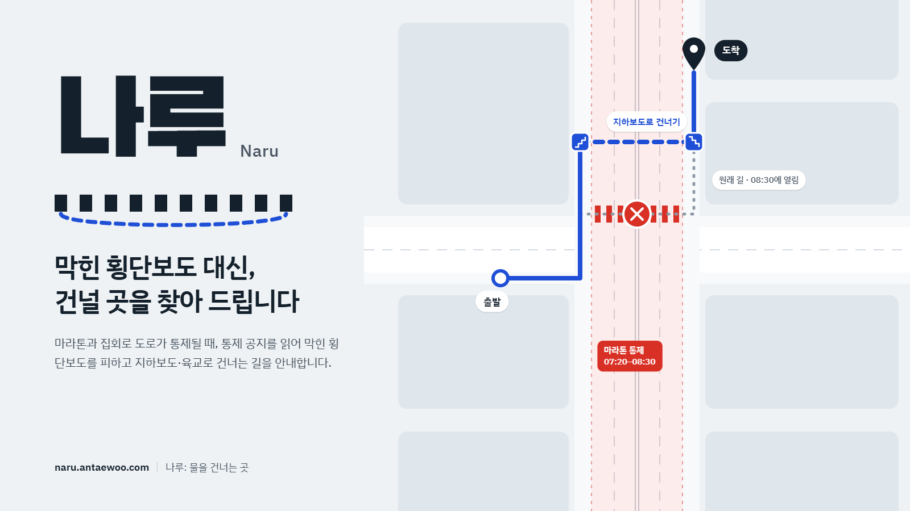
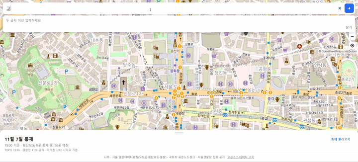
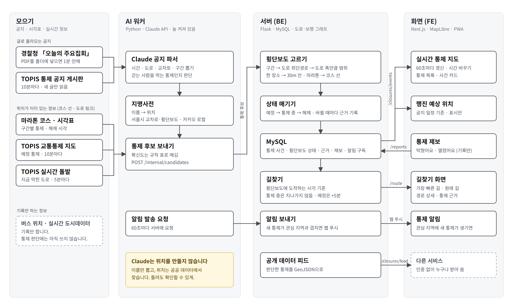
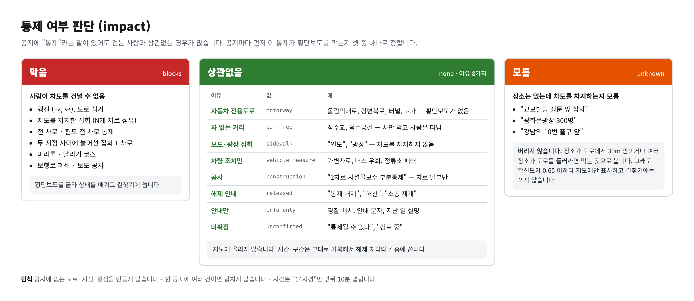
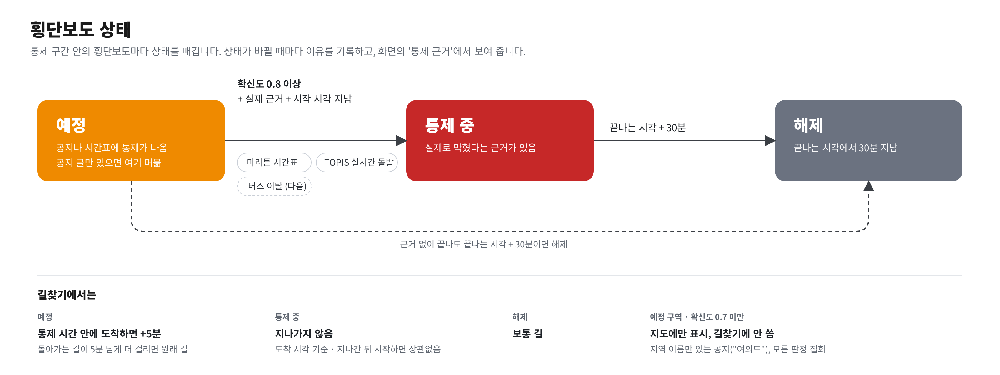
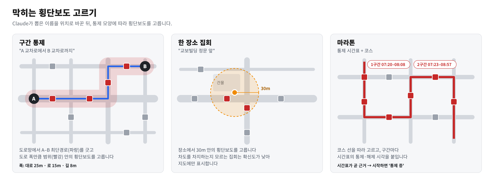

# 나루 (Naru)

마라톤이나 집회로 막힌 횡단보도를 피해서 걷는 길을 알려 주는 서비스입니다.

**서비스 주소:** https://naru.antaewoo.com

<p align="center">
  
</p>

## 만든 이유

지도 앱은 도로 통제를 모릅니다. 통제 정보는 경찰청과 서울시 공지에 글로만 올라옵니다.

통제는 드문 일이 아닙니다. 서울에서는 올해 대규모 교통통제만 30차례가 넘었습니다([기사](https://www.koreancenter.or.kr/news/articleView.html?idxno=1433329)). 저희가 설문한 71명 중 69%가 통제로 길이 막힌 적이 있었고, 59%가 마라톤·집회 때였습니다.

나루는 이 공지를 읽고 어느 횡단보도가 언제 막히는지 계산합니다. 그리고 막힌 곳을 피해서 길을 찾습니다.

## 기능



- **통제 지도:** 지금 막힌 곳, 곧 막힐 곳, 지하보도 입구를 지도에 보여 줍니다.
- **시간 바꾸기:** 시각을 옮기면 그때의 통제 상황을 보여 줍니다.
- **통제 불러오기:** 지난 통제를 골라 볼 수 있습니다.
- **길찾기:** 지금 갈 수 있는 길과 원래 길을 나란히 보여 줍니다. 원래 길이 언제 열리는지도 알려 줍니다.
- **경로 상세:** 계단, 지하보도, 육교처럼 지나는 구간을 보여 줍니다.
- **통제 근거:** 어떤 공지를 보고 막혔다고 판단했는지 보여 줍니다.
- **링크 공유:** 같은 시각, 같은 경로를 링크로 보낼 수 있습니다.

예를 들어 2026년 3월 15일 서울마라톤 날 오전 7시 45분에 교보빌딩 앞에서 대한문까지 가 보면, 세종대로 횡단보도가 막혀 있습니다. 나루는 지하보도로 건너는 12분 길을 안내합니다. 원래 11분 길은 8시 30분에 열린다고 알려 줍니다. ([예시 경로 열기](https://naru.antaewoo.com/?t=2026-03-15T07%3A45%3A00%2B09%3A00&from=37.5709686446227,126.9779039768265&to=37.5650416322942,126.976542945622))

## 동작 방식



1. 경찰청, 서울시, TOPIS 공지와 마라톤 통제 시간표를 모읍니다.
2. Claude가 공지에서 시간, 도로 이름, 교차로 이름, 통제 구간을 뽑습니다. 이 통제가 사람 통행을 막는지, 얼마나 믿을 만한지도 판단합니다.
3. 뽑은 이름을 공공 데이터에서 찾아 위치로 바꿉니다. Claude가 위치를 직접 만들지는 않습니다. 위치를 모델이 만들면 틀려도 확인할 방법이 없기 때문입니다.
4. 통제 구간 안에 있는 횡단보도를 찾고, 횡단보도마다 상태(예정, 통제 중, 해제)를 매깁니다.
5. 상태에 따라 막힌 횡단보도를 피해서 길을 찾습니다.

## 주요 로직

### 통제 여부 (impact)

공지에 "통제"라는 말이 있어도 걷는 사람과 상관없는 경우가 많습니다. 그래서 공지마다 횡단보도를 막는지 먼저 판단합니다.



| 값                | 뜻                                         | 예                                                          |
| ----------------- | ------------------------------------------ | ----------------------------------------------------------- |
| 막음 (`blocks`)   | 사람이 차도를 건널 수 없음                 | 행진, 차도를 차지한 집회, 전 차로 통제, 마라톤, 보행로 폐쇄 |
| 상관없음 (`none`) | 통제는 있지만 걷는 데는 영향 없음          | 아래 이유 표                                                |
| 모름 (`unknown`)  | 장소는 있는데 차도를 차지하는지 알 수 없음 | "교보빌딩 정문 앞 집회"                                     |

'상관없음'은 이유를 같이 적고, 지도에 올리지 않습니다.

| 이유            | 값                | 예                                                |
| --------------- | ----------------- | ------------------------------------------------- |
| 자동차 전용도로 | `motorway`        | 올림픽대로, 강변북로, 터널, 고가. 횡단보도가 없음 |
| 차 없는 거리    | `car_free`        | 잠수교, 덕수궁길. 차만 막고 사람은 다님           |
| 보도·광장 집회  | `sidewalk`        | 차도를 차지하지 않음                              |
| 차량 조치만     | `vehicle_measure` | 가변차로, 버스 우회                               |
| 공사            | `construction`    | 차로 일부만 막음                                  |
| 해제 안내       | `released`        | "통제 해제", "해산"                               |
| 안내만          | `info_only`       | 경찰 배치, 안내 문자                              |
| 미확정          | `unconfirmed`     | "통제될 수 있다", "검토 중"                       |

'모름'인 집회는 위치를 보고 정합니다. 집회 장소가 도로에서 30m 안에 있거나, 여러 장소가 도로를 둘러싸고 있으면 막는 것으로 봅니다. 그 밖(광장, 공원)이면 지도에 범위만 표시합니다. 막는 것으로 보더라도 확신도가 낮아서 길찾기에는 쓰지 않습니다.

공지를 읽을 때 지키는 원칙이 셋 있습니다.

- 공지에 없는 도로, 지점, 끝 지점을 만들지 않습니다.
- 한 공지에 통제가 여러 건이면 합치지 않고 따로 뽑습니다. 시간이 다른 통제를 합치면 시간이 틀어집니다.
- 시간은 임의로 넓히지 않습니다. "14시경"처럼 대략일 때만 앞뒤 10분씩 넓힙니다.

### 확신도

통제마다 0에서 1 사이의 확신도를 붙입니다. LLM이 느낌으로 정하지 않고 아래 표대로 매깁니다.

| 공지                                                  | 확신도 |
| ----------------------------------------------------- | ------ |
| 마라톤 통제 시간표                                    | 0.90   |
| TOPIS 통제 공지 (시간, 구간, 차로가 다 있음)          | 0.90   |
| TOPIS 통제 공지 (차로 정보 없음)                      | 0.80   |
| TOPIS 실시간 돌발 — 집회 (TOPIS가 도로에 등록한 통제) | 0.90   |
| 경찰청 행진, 도로 이름 있음                           | 0.85   |
| 경찰청 행진, 도로 이름 없음                           | 0.75   |
| 두 지점 사이에 늘어선 집회                            | 0.75   |
| 한 장소 집회, 1,000명 이상                            | 0.65   |
| 한 장소 집회, 1,000명 미만                            | 0.45   |
| 지역 이름만 있음 ("여의도")                           | 0.40   |
| 상관없음 (`none`)                                     | 0      |

정보가 모자라면 깎습니다.

- 끝나는 시각이 없으면 0.15를 뺍니다. 이때는 시작하고 6시간 뒤를 끝으로 봅니다.
- "14시경", "오후"처럼 시각이 대략이면 0.10을 빼고, 시간을 앞뒤로 10분씩 넓힙니다.
- 장소 이름을 정확히 찾지 못하면 0.10을 뺍니다.
- 끝 지점 없이 "을지로입구역 방향"만 있는 행진은 출발지에서 그 방향 지점까지 선을 긋고, 최대 0.65로 둡니다. 방향 지점을 찾지 못하면 출발지만 씁니다.
- 통제 여부를 '모름'으로 판단한 집회도 최대 0.65입니다.

확신도가 0.7보다 낮으면 지도에만 표시하고 길찾기에는 쓰지 않습니다.

### 상태: 예정 → 통제 중 → 해제



| 상태      | 언제                                                                 |
| --------- | -------------------------------------------------------------------- |
| 예정      | 공지나 시간표에 통제가 나왔을 때                                     |
| 통제 중   | 확신도가 0.8 이상이고, 실제 근거가 있는 통제가 시작 시각을 지났을 때 |
| 해제      | 끝나는 시각에서 30분이 지났을 때                                     |
| 예정 구역 | 지역 이름만 있어서 횡단보도를 특정할 수 없을 때 (지도에만 표시)      |

'실제 근거'는 지금 두 가지입니다. 마라톤 통제 시간표, 그리고 TOPIS 실시간 돌발(집회)입니다. 돌발은 그 도로의 횡단보도를 바로 '통제 중'으로 만들고, 같은 횡단보도에 걸린 공지 통제에도 근거로 붙습니다. 공지 확신도가 0.8 이상이면 그 공지 통제도 '통제 중'이 됩니다.

공지 글만 있는 통제는 시간이 지나도 '예정'으로 남습니다. 글만으로는 현장에서 정말 막혔는지 알 수 없기 때문입니다. 상태가 바뀔 때마다 이유가 기록되고, 화면의 '통제 근거'에서 볼 수 있습니다.

### 막히는 횡단보도 고르기



- **구간 통제** ("A 교차로에서 B 교차로까지"): 도로망에서 A와 B를 잇는 가장 짧은 길을 선으로 긋습니다. 도로 폭만큼 범위를 잡고 그 안의 횡단보도를 고릅니다. 폭은 도로 이름이 '대로'면 25m, '로'면 15m, '길'이면 8m입니다.
- **한 장소 집회:** 그 장소에서 30m 안의 횡단보도를 고릅니다.
- **마라톤:** 코스 선을 따라 고릅니다. 구간마다 시간표의 통제·해제 시각을 붙입니다.

### 길찾기

- 걷는 속도는 초속 1.2m로 계산합니다.
- 통제는 출발 시각이 아니라 그 횡단보도에 도착하는 시각을 기준으로 봅니다. 지나간 뒤에 시작하는 통제는 피하지 않습니다.
- '통제 중'인 횡단보도는 지나가지 않습니다.
- '예정'인 횡단보도는 통제 시간 안에 도착하면 5분이 더 걸리는 것으로 칩니다. 돌아가는 길이 5분 넘게 더 걸리면 원래 길로 갑니다. 현장 확인 전이라 아예 막지는 않습니다.
- 계단은 25m, 엘리베이터는 40m를 더 걷는 것으로 칩니다.
- 출발지나 도착지가 보행 도로에서 150m 넘게 떨어져 있으면 지원 범위 밖이라고 알려 줍니다.
- 원래 길은 같은 지도에서 통제를 무시하고 찾습니다. 원래 길에서 막힌 횡단보도와 풀리는 시각을 같이 보여 줍니다.

예를 들어 2026년 11월 7일 오후 3시에 세종대로를 건너는 길은, 공지로만 알려진 집회(15:00~16:00) 때문에 지하보도로 돌아가는 16분 길을 고릅니다. 원래 길은 15분입니다.

## 실행 방법

필요한 것: Python 3.12와 [uv](https://docs.astral.sh/uv/), Node.js와 pnpm, Docker (MySQL 8.4)

```bash
git clone <repo-url> naru && cd naru
make setup      # Python·Node 의존성 설치
make check      # 린트·타입·테스트 (키 없이 기록으로 돔)
make serve      # MySQL → 마이그레이션 → 빌드 → http://127.0.0.1:3050
uv run python -m naru_ai.worker --loop   # 워커: 코스 · 공지 · TOPIS 돌발 5분 · 전면 통제·마라톤 버스 위치 60초 기록 (운영은 deploy/naru-worker.service)
```

새 공지를 실제로 읽거나 지도 타일을 바꾸려면 `.env`에 키를 넣습니다: `ANTHROPIC_API_KEY`, 카카오 로컬·서울 열린데이터광장 키, 그리고 `packages/fe/.env.local`의 `NEXT_PUBLIC_VWORLD_KEY`.

## 기술 스택

| 부분    | 쓰는 것                                                              |
| ------- | -------------------------------------------------------------------- |
| 화면    | Next.js (App Router), React 19, TypeScript, MapLibre GL JS           |
| 서버    | Python 3.12, Flask 3 (MVC), SQLAlchemy, MySQL 8.4, NetworkX, Shapely |
| AI 워커 | Python 3.12, Anthropic Claude API (`claude-haiku-5-5`, tool use)     |
| 계약    | pydantic v2 (`naru_contracts`). 화면 타입은 여기서 생성              |

AI 워커와 서버는 서로의 코드를 가져다 쓰지 않고, HTTP와 계약 패키지로만 주고받습니다.

## 폴더 구조

```
naru/
├── packages/
│   ├── contracts/   AI·서버·화면이 주고받는 데이터 정의
│   ├── ai/          공지 수집 · Claude 파서 · 지명사전
│   ├── be/          횡단보도 고르기 · 상태 · 길찾기 API
│   └── fe/          지도 화면
├── data/raw/        받은 공공 데이터 (수정하지 않음)
├── data/recorded/   외부 API·Claude 응답 기록
├── docs/            계약 · 규칙서 · 평가 결과 · 결정 기록
└── harness/         개발 진행 기록 (Claude Code)
```

## 데이터 피드

나루가 판단한 통제를 누구나 GeoJSON 으로 받을 수 있습니다. 인증 없음, CORS 열림, 1분 캐시, IP 당 1분에 60번까지.

```
curl "https://naru.antaewoo.com/api/closures/feed?at=2026-11-07T13:00:00%2B09:00"
```

`at` 을 빼면 지금 기준입니다. 응답은 FeatureCollection 이고, `features[].properties.kind` 로 셋을 나눕니다.

| kind | geometry | 뜻 |
| --- | --- | --- |
| `crosswalk` | Point | 그 사건이 막는 횡단보도. `crosswalk_id`(서울시 관리번호), `name`(교차로명), `status`(`confirmed` 통제 중 · `scheduled` 예정 · `released` 해제), `confidence`(0~1), 행진 확률 모델 사건이면 `p`(그 시각 막혀 있을 확률) |
| `area` | Polygon · MultiPolygon | 사건 통제 구역 |
| `march_path` | LineString | 행진 경로 (방향을 아는 행진만) |

세 종류 다 사건 칸이 같습니다: `event_id`, `event`(이름), `type`(`marathon` · `march` · `rally` · `event`), `source`(`course` · `smpa` · `topis` · `incident` …), `start`, `end`. 맨 위 `at`(기준 시각)·`generated_at`·`attribution`(출처 표시 — 꼭 함께 쓰세요)도 있습니다. 필드 정의는 `docs/INTERFACE.md` §3.3 에 있습니다. 공지를 읽어 만든 추정값이라 실제 통제와 다를 수 있습니다.

## 한계

- 서울 전체만 지원합니다.
- TOPIS 실시간 돌발(집회)은 5분마다 받습니다. 공지는 아직 저장해 둔 것으로 시연합니다. <!-- T6.4 게시판 수집 끝나면 고치기 -->
- 공지로만 알려진 통제는 정말 막혔는지 알 수 없습니다. 그래서 되도록 피하는 정도로만 반영합니다.

## 앞으로

- 2027년 3월 서울국제마라톤 현장에서 예측한 통제와 실제 통제를 비교합니다.
- 2027년 3월 서울마라톤에서 버스 정류소 건너뜀으로 구간별 실제 통제·해제 시각을 확인합니다. 11월 9일 실측에서 부분 차로 행진에는 버스 신호가 맞지 않음을 확인해 전면 통제·마라톤으로 범위를 좁혔습니다.

## 데이터 출처

| 출처                                                                   | 쓰는 곳                              |
| ---------------------------------------------------------------------- | ------------------------------------ |
| 서울 열린데이터광장 — 도보 네트워크, 횡단보도, 교차로                  | 보행 그래프, 횡단보도 위치, 지명사전 |
| 서울 열린데이터광장 — TOPIS 실시간 돌발정보 (OA-13315, 공공누리 1유형) | '통제 중' 근거                       |
| 국토교통부 표준노드링크                                                | 도로 그래프                          |
| 서울경찰청 「오늘의 주요집회」                                         | 집회·행진 공지                       |
| 서울시 TOPIS 통제 공지                                                 | 당일 통제 구간                       |
| 서울시 서울마라톤 공지                                                 | 마라톤 코스·통제 시간표              |
| 카카오 로컬 API                                                        | 장소 이름 찾기                       |
| OpenStreetMap (ODbL)                                                   | 지도 타일                            |
| MapLibre GL JS (BSD-3-Clause)                                          | 지도 그리기                          |
| Anthropic Claude API                                                   | 공지 읽기                            |

라이선스 전문은 서비스의 [오픈소스·데이터 고지](https://naru.antaewoo.com/licenses)에 있습니다.
